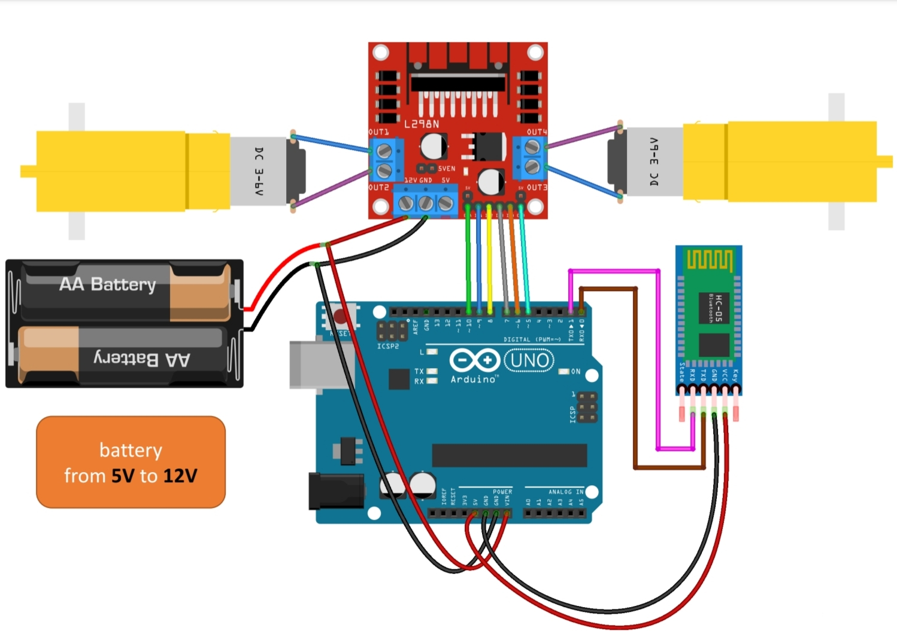

# Bluetooth Controlled RC Car 🚗

A simple Arduino-based robotic car controlled wirelessly via Bluetooth using a smartphone application.

---

## 📌 Features
- **Wireless Control:** Controls car movements (Forward, Backward, Left, Right, Stop) via Bluetooth.
- **SoftwareSerial Integration:** Uses digital pins 2 and 3 for Bluetooth communication, allowing code upload without disconnecting the HC-05 module.
- **Motor Control:** Drives two DC motors using the L298N motor driver with PWM speed control.

---

## 🛠️ Hardware Components
- Arduino Uno
- L298N Motor Driver Module
- HC-05 Bluetooth Module
- 2x DC Motors with Wheels
- Power Supply (5V to 12V Battery Pack)
- Jumper Wires & Chassis

---

## 🔌 Circuit & Wiring

### Pin Mapping Table
| Component | Module Pin | Arduino Pin |
| :--- | :--- | :--- |
| **HC-05 Bluetooth** | TX | Digital Pin 2 (RX) |
| **HC-05 Bluetooth** | RX | Digital Pin 3 (TX) |
| **L298N Driver** | ENA (speedL) | Digital Pin 10 |
| **L298N Driver** | IN1, IN2 | Digital Pins 9, 8 |
| **L298N Driver** | IN3, IN4 | Digital Pins 7, 6 |
| **L298N Driver** | ENB (speedR) | Digital Pin 5 |

---

## 🎮 Bluetooth Control Commands
The smartphone app sends single-character commands via Bluetooth to control the car:

| Command | Action |
| :---: | :--- |
| **`F`** | Move Forward |
| **`B`** | Move Backward |
| **`L`** | Turn Left |
| **`R`** | Turn Right |
| **`S`** | Stop |
